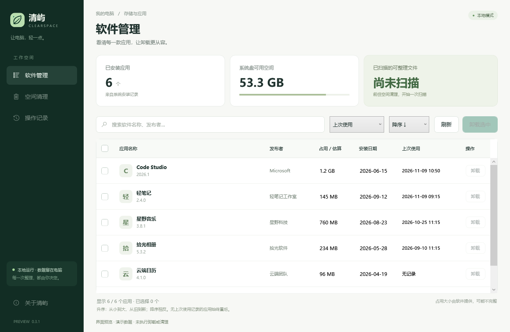
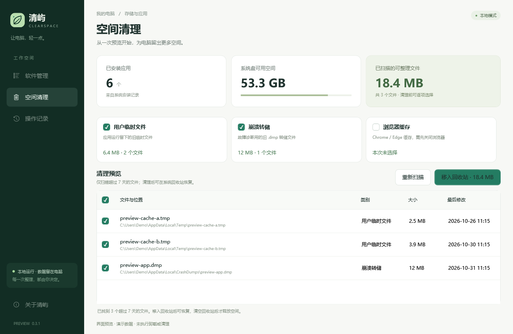
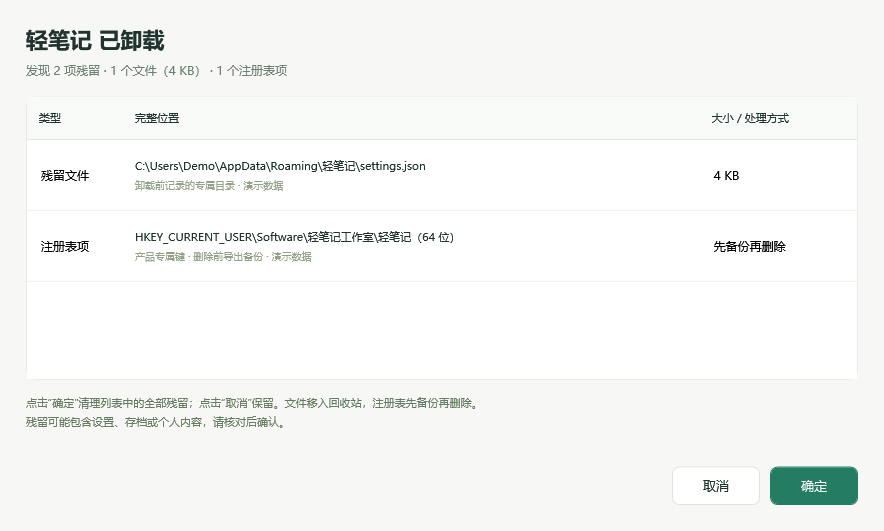

# 清屿 ClearSpace

[](https://github.com/Jwforever/ClearSpace/releases)
[](https://github.com/Jwforever/ClearSpace/actions/workflows/build.yml)


一个 Windows 10 / 11 软件管理与空间整理工具。中文界面，本地运行，无需账号。

**[下载最新版 Windows 便携包](https://github.com/Jwforever/ClearSpace/releases/latest)** · [查看源码](https://github.com/Jwforever/ClearSpace)

## 使用

从 Releases 下载 `ClearSpace-0.3.1-win-x64.zip`，解压后双击 `ClearSpace.exe`。适用于 Windows 10 / 11 x64，自带 .NET 运行时，无需安装。

在“软件管理”中搜索、排序和查看安装记录，选中软件后可依次启动其自带的卸载程序。在“空间清理”中先扫描，再核对具体文件，最后确认将选中文件移入系统回收站。

排序字段和方向分别选择。例如“上次使用 + 升序”把最久未使用的软件排在前面，“上次使用 + 降序”把最近使用的排在前面；没有记录的软件始终置后。

卸载完成并从安装列表移除后，清屿会自动扫描，并弹出残留清单。弹窗列出文件和注册表项的完整位置，**点击“确定”直接清理列表中的全部残留，点击“取消”或关闭窗口则保留**，无需勾选或再次确认。残留可能包含设置、存档或个人内容，请核对后确认。批量卸载时逐个处理；卸载器的子进程延迟移除安装记录时，会在检测到变化后自动弹出。

## 功能

- 读取 HKLM / HKCU 中 32 位和 64 位安装记录，支持搜索、排序和批量卸载队列。
- 每个卸载器结束后自动刷新；卸载期间每 2 秒检查安装记录，队列结束后继续检查 3 分钟，之后返回窗口时也会再次检查待确认的软件。刷新保留搜索、排序和其余软件的勾选状态。
- 支持软件名称、占用大小、安装日期、上次使用、发布者 5 个字段，搭配独立的升序 / 降序选择；缺失的大小、日期或使用记录始终置后。
- 卸载前记录已存在的产品专属位置；卸载程序退出且安装记录移除后，自动扫描并弹出残留清单，确定即清理，取消则跳过。每次卸载只提示一次；尚未完成的卸载记录在重启后保留，最多保存最近 100 个软件。
- 残留文件移入回收站；产品专属注册表项先导出 `.reg` 备份再删除，备份失败则跳过。清理前再次检查安装状态、共用位置和扫描后变化。
- 显示系统盘可用空间与软件提供的安装大小。
- 扫描超过 7 天的用户临时文件、崩溃转储，以及 Chrome / Edge 文件缓存。
- 清理前预览文件名、完整路径、大小、最后修改时间和来源分类，可逐项取消选择。
- 清理时再次检查允许的根目录、文件属性、大小与修改时间，只移入系统回收站。
- 浏览器运行时跳过其缓存；跳过链接、系统文件、只读文件和独占使用中的文件。
- 在 `%LOCALAPPDATA%\ClearSpace\history.json` 保存最近 500 条操作记录。每条记录最多保存 100 个文件路径与 100 条跳过原因。
- 应用本身不联网，不收集遥测，不上传软件列表或文件路径。

## 界面

下图使用虚构应用与文件，不包含个人软件列表。







## 0.3.1 更新

- 移除独立的“卸载残留”菜单、页面和软件管理中的“清理残留”按钮。
- 改为卸载完成后自动扫描并弹出清单，只需点击“确定”清理全部列出项，或点击“取消”保留，无需逐项勾选和二次确认。
- 支持卸载期间和队列结束后的延迟完成检测，取消或关闭弹窗后不再重复提示；升级时不会自动弹出旧版手动管理的历史记录。
- 保留文件回收站、注册表删除前备份、变化检查和共用位置排除。
- 界面检查覆盖完整自动流程，包括确定、取消、关闭、延迟卸载与重复弹窗防护，使用虚构数据验证，不卸载真实软件。

## 0.3.0 更新

- 拆分排序字段与方向，5 个字段均支持升序和降序，共 10 种组合，刷新后保留选择。
- 新增“卸载残留”页面和软件管理中的“清理残留”入口，支持查看文件、设置及产品专属注册表项的候选清单。
- 卸载前记录位置，卸载后才开放清理；所有候选默认不选，清理前单独确认。
- 注册表删除前生成 UTF-16 `.reg` 备份和恢复说明，备份目录可直接打开，操作记录中保留其位置。
- 跳过共用目录、仍安装的组件、重新安装的软件、链接及扫描后发生变化的项目；不递归永久删除文件夹。
- 增加隔离的残留清理检查，覆盖注册表备份、删除和实际导入恢复，并检查残留预览及全部排序组合。

## 0.2.0 更新

- 卸载后逐个自动刷新，并处理卸载器启动子进程、延迟移除安装记录的情况。
- 新增上次使用时间列，以及最近优先、最久优先两种排序。
- 从当前用户的 Windows UserAssist 运行记录读取最近启动时间，解析本地快捷方式目标，以完整程序路径及明确的安装目录关联应用。安装器、卸载器及无法区分的软件共用目录不用于推断使用时间。
- 没有记录时显示“无记录”，不使用安装日期、文件修改时间或文件访问时间代替。
- 增加延迟卸载刷新、排序、刷新状态保留和使用记录解析的检查。

## 0.1.1 更新

- 增加原创叶片图标：SVG 源文件、多尺寸 Windows ICO、EXE、窗口标题栏与应用内标志。
- 修复磁盘使用率进度条错误使用双向绑定造成的启动报错。
- 增加窗口启动、图标加载、四个页面和搜索筛选的自动检查。
- 增加 GitHub Actions 构建检查与 Windows 发布流程。

## 功能边界

安装列表不包含 Microsoft Store 应用或未登记的便携软件；软件自报的占用大小可能缺失或不完整。卸载需要完成原软件的向导，列表根据 Windows 安装记录自动更新，只有记录实际移除后才移除对应行。停止队列只会停止等待或后续任务，已经启动的卸载程序由其自身控制。

“上次使用”是 Windows 为当前用户保留的最近启动记录，属于尽力获取的数据，不是完整的活动审计。关闭 Windows 应用启动跟踪、历史记录被清除、应用未由资源管理器/开始菜单启动、快捷方式已经删除，或安装记录不足以关联程序时，可能显示“无记录”。这不表示从未使用；应用不会开启系统跟踪或要求管理员权限，也不将读取的运行历史写入文件。

残留功能只支持**从 0.3.0 起通过清屿发起、且已在卸载前记录位置的卸载**。旧版操作历史、其他工具已经卸载的软件无法补录扫描。识别范围为 Program Files、AppData 和 ProgramData 下能明确关联产品的目录，以及 `HKCU/HKLM\Software\产品名`、`Software\发布者\产品名` 等具体键；不按关键词遍历整个注册表，无法保证识别全部残留。自定义磁盘位置、名称无法关联的位置、共用目录和大型发布者的共享键可能不包含在候选中。

清理不修改服务、启动项、COM 或 Windows Installer 注册信息，不主动提升权限。权限不足的项目会跳过，不递归永久删除目录，空文件夹可能保留。空间清理仍只覆盖指定缓存与临时目录；下载、文档等个人目录不会作为清理根目录。

注册表备份位于 `%LOCALAPPDATA%\ClearSpace\RegistryBackups\`，操作记录中也会写入具体任务的备份路径；可从“操作记录 → 打开记录文件夹”进入 `RegistryBackups`。每次任务附恢复说明：64 位备份使用 `reg.exe import "备份文件.reg" /reg:64`，32 位使用 `/reg:32`；HKLM 恢复通常需要管理员权限。备份恢复键和值，不包含原来的访问权限设置；恢复前请关闭相关软件。

移入回收站后可通过系统回收站恢复，清空回收站后才实际释放空间。清理失败或跳过的文件会记录原因；残留弹窗取消后不再重复提示，任务中断时请通过操作记录核对已处理项。

## 开发和验证

需要 Windows 10 / 11 与 .NET 8 SDK。

```powershell
# 构建桌面应用
dotnet build src/ClearSpace.App/ClearSpace.App.csproj -c Release

# 运行隔离检查、发布便携包、执行界面检查
.\check.ps1

# 只发布
.\publish.ps1
```

发布结果位于 `dist/`，包括自带运行时的单文件 EXE、分发 ZIP 和 SHA256 校验文件。

核心检查使用唯一的 `%TEMP%\ClearSpace.Checks.<random>` 目录。回收站集成检查仅操作在该目录中新建的测试文件；残留检查另在唯一的 `%LOCALAPPDATA%\ClearSpace.Checks.<random>` 目录和 `HKCU\Software\ClearSpace.Checks.<random>` 测试键中验证，退出时清除测试夹具。注册表恢复检查实际导入测试键的备份，不操作已安装软件。

界面检查使用虚构数据和模拟执行器，不执行真实卸载或清理，验证全部 10 种排序组合、无记录置后、定时刷新识别延迟移除、搜索/勾选/方向状态保留，以及自动残留弹窗的确定、取消、关闭和防重复行为，结果输出到 `dist/ui-smoke/`。

图标源文件位于 `assets/clearspace-mark.svg`；`tools/generate_brand.py` 使用 Pillow 生成配套 PNG、ICO 与横幅。

## 项目说明

维护者：[Jwforever](https://github.com/Jwforever)。应用使用 .NET / WPF 与 Windows 系统功能，没有复制 BCUninstaller 或 BleachBit 的源码。导航字形使用 Windows 自带的 Segoe MDL2 Assets，应用标志为项目原创。

仓库目前未指定开源许可证。
